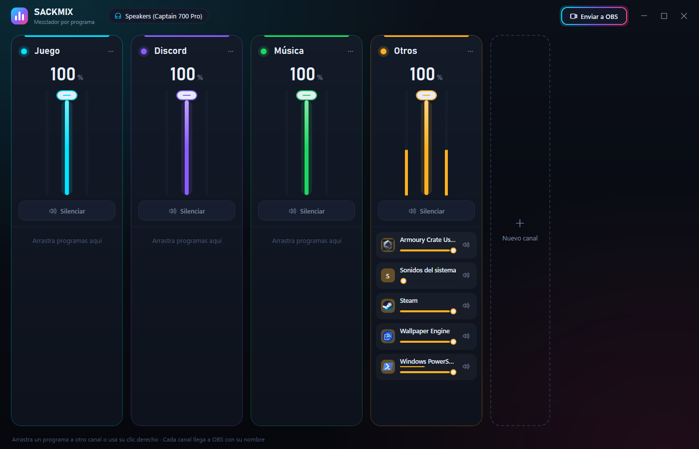

# SackMix

Mezclador de audio por programa para Windows 10 y 11. Cada programa que suena (Discord, Spotify, el juego,
el navegador…) cae en un **canal con nombre** —Juego, Discord, Música, Otros, o los que crees— y cada canal
tiene su fader, su silencio y su medidor. Dentro del canal, cada programa tiene además su propio volumen y
silencio. Con un botón, cada canal aparece en **OBS** como una fuente de audio con ese mismo nombre.

## Uso

- **Abrir:** `dist\SackMix.exe` (un solo archivo, no necesita .NET instalado). Solo se abre una copia.
- **Canales:** el nombre se edita encima; el punto de color lo cambia; «⋯» cambia el color o borra el canal
  (sus programas pasan a «Otros», que no se puede borrar y recoge todo lo que nadie colocó). «Nuevo canal» crea otro.
- **Mover un programa:** arrástralo por su icono o su nombre a otro canal, o clic derecho → «Mover a…»
  (con teclado: foco en su barra y Shift+F10). Se recuerda por programa.
- **Primer reparto automático:** Discord/TeamSpeak/Mumble → Discord; Spotify, Apple Music, TIDAL… → Música;
  lo instalado en `steamapps\common`, Epic, Riot, Xbox, GOG… y Minecraft (Java y Bedrock) → Juego; el resto → Otros.
- **Volumen real** = volumen del programa × volumen del canal; silenciado si lo está cualquiera de los dos.
  Si mueves un programa en el mezclador de Windows, SackMix lo toma como el nuevo volumen del programa.
- **Salidas:** sigue a los programas en **todas** las salidas activas (por si Discord usa otra). Los sonidos del
  sistema solo se toman de la salida predeterminada, porque cada salida tiene los suyos a su propio nivel.
- **Ajustes:** `%LOCALAPPDATA%\SackMix\config.json` (se guarda 0,8 s después del último cambio). Errores en `sackmix.log`.

## OBS

«Enviar a OBS» crea en la escena actual una **Captura de audio de aplicación** (la de OBS 28+) por programa,
con el nombre del canal: «Discord», o «Música · Spotify» si el canal tiene varios. Si ya existen, solo las
vuelve a apuntar al programa. No pide nada: lee el puerto y la contraseña del propio OBS
(`%APPDATA%\obs-studio\plugin_config\obs-websocket\config.json`). OBS tiene que estar abierto, con el servidor
WebSocket activado (Herramientas → Ajustes del servidor WebSocket).

Cosas de OBS que conviene saber:

- La captura sigue al volumen por programa de Windows: lo que silencias en SackMix también se silencia en OBS.
  Para el directo, cada fuente tiene además su propio fader dentro de OBS.
- OBS busca el programa por una ventana visible: un Discord minimizado a la bandeja no se captura hasta que su
  ventana existe (OBS reintenta solo).
- Los «Sonidos del sistema» no se envían (no tienen programa ni ventana).

## Por qué no hay «dispositivos virtuales»

Programas como SteelSeries Sonar crean salidas de audio falsas («Sonar - Chat», «Sonar - Media») con un driver
de núcleo. Un driver así necesita firma de Microsoft (certificado EV), así que SackMix no instala ninguno:
controla el volumen de cada sesión de Windows y usa la captura por programa que OBS ya trae.

## Consumo (Ryzen 5 5600G, versión publicada, medido el 2026-10-26)

| Estado | CPU del equipo | Memoria privada |
|---|---|---|
| Visible, medidores en marcha | 0,13 % | 50 MB |
| Minimizada | 0,00 % | 42 MB |

Abre en 0,8 s. Cómo lo consigue: todo el audio va en un hilo propio que duerme si no hay trabajo; los medidores
se leen a 30 fps solo con la ventana visible; la ventana se dibuja por CPU (con la GPU integrada eran 147 MB y
más CPU, porque solo cambian los medidores); sin efectos de desenfoque; ejecutable precompilado (ReadyToRun) y
sin comprimir.

## Desarrollo

- `dotnet test SackMix.slnx` — 20 pruebas: reparto, mezcla, archivo de ajustes y OBS (contra un servidor
  falso que habla obs-websocket 5, incluida la contraseña).
- `.\publish.ps1` — pruebas y `dist\SackMix.exe` (autocontenido, ~141 MB en disco).
- `tools\generar-icono.ps1` — regenera `Assets\sackmix.ico`.

Estructura: `src/SackMix.Core` (canales, reglas, ajustes y OBS, sin WPF), `src/SackMix` (WPF: `Audio/` es la
API Core Audio de Windows sin librerías externas, `ViewModels.cs`, `MainWindow.xaml`, `Theme.xaml`),
`tests/SackMix.Tests`.
